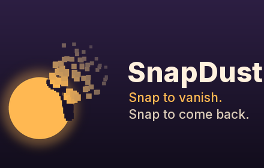

# SnapDust

Snap your fingers on a Google Meet call and crumble into dust. Snap again and fly back together in a swirl of gold.

## How to use it

1. Install SnapDust and open (or reload) a Google Meet tab.
2. Open the SnapDust popup and click **Capture empty room**, then step aside for a few seconds so it can see the room behind you.
3. Hold your hand up, thumb and middle finger together, and snap. You turn to dust.
4. Snap again to come back.

The popup also has **Vanish** and **Capture** buttons, and keyboard shortcuts (Alt+Shift+V, Alt+Shift+B).

## Privacy

Everything happens on your computer; nothing is recorded or sent anywhere. See the [privacy policy](privacy).

## Feedback

Bugs, ideas and criticism are very welcome: [open an issue](https://github.com/ihemanthm/snapdust/issues). The code is at [github.com/ihemanthm/snapdust](https://github.com/ihemanthm/snapdust).

SnapDust is an independent project and is not affiliated with or endorsed by Google.
